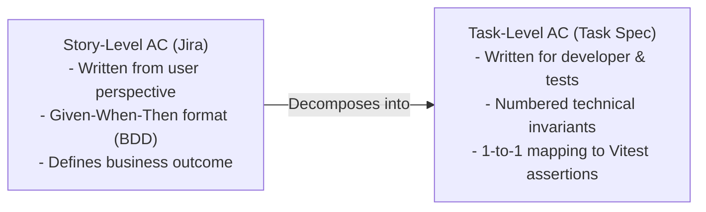

# Acceptance Criteria Guide & Ticket Templates

This guide establishes the team's standard for defining, formatting, and verifying **Acceptance Criteria (AC)** across Jira tickets and task specification documents.

In our Sprint 1 retrospective, we identified that vague tickets led to misaligned expectations and implementation delays. This guide provides actionable standards to ensure every ticket has clear, testable, and unambiguous requirements.

---

## 1. The Two Levels of Acceptance Criteria

Acceptance criteria operate at two distinct levels in our project:



### 1.1 Story-Level Acceptance Criteria (Jira User Stories)

User stories capture functionality from the perspective of an end user or stakeholder. Story-level criteria should follow the **Given-When-Then** format (Behavior-Driven Development):

- **Given:** The initial context, user state, or precondition.
- **When:** The specific action or event triggered by the user.
- **Then:** The observable outcome, system response, or state change.

#### Example (Jira Story):

> **Story:** _As a prospective renter, I want Verilet to flag security deposits that violate California state law so that I don't overpay upfront._
>
> **Acceptance Criteria:**
>
> 1. **Standard Deposit:**
>    - **Given** a listing with monthly rent of \$2,500 and a security deposit of \$2,500 (1x rent),
>    - **When** the listing is evaluated,
>    - **Then** the check passes as `compliant` with zero red flags and confirms AB 12 compliance.
> 2. **Excessive Deposit Violation:**
>    - **Given** a listing with monthly rent of \$2,500 and a security deposit of \$6,000 (> 2x rent),
>    - **When** the listing is evaluated,
>    - **Then** the check returns status `violation`, flags `ILLEGAL_SECURITY_DEPOSIT`, and cites Cal. Civ. Code § 1950.5(c).
> 3. **Unspecified Financials:**
>    - **Given** a listing where the deposit amount is not provided,
>    - **When** the evaluation runs,
>    - **Then** the status is marked `skipped` without generating false-positive warnings or errors.

---

### 1.2 Task-Level Acceptance Criteria (Task Specs in `docs/tasks/`)

Sprint task specs (`docs/tasks/sprint-N/<task-id>.md`) define technical execution units. Task-level criteria must be written as **numbered, declarative, testable technical invariants**.

Every criterion must:

- Specify concrete expected behaviors, error codes, payload keys, or return types.
- Cover normal behavior, boundary conditions, and error/exception states.
- Avoid subjective words (e.g., _"works properly"_, _"looks clean"_, _"fast"_).
- **Strictly map 1-to-1** with an entry in the `## Tests` table and an automated test file in `client/tests/` or `server/tests/`.

#### Example (Task Spec):

```markdown
## Acceptance criteria

1. An application fee less than or equal to $65 returns status: "compliant" with statutoryCitation "Cal. Civ. Code § 1950.6".
2. An application fee exceeding $65 returns status: "violation" and triggers flag EXCESSIVE_APPLICATION_FEE.
3. Missing, null, or undefined fee inputs return status: "skipped" with zero red flags.
4. An application fee of exact boundary value $65 returns status: "compliant".
5. Negative numeric values or non-numeric types return { success: false, error: "Invalid application fee value" } without throwing unhandled exceptions.
```

---

## 2. Quality Principles (INVEST Checklist)

Before approving a Jira ticket or task spec, verify that the acceptance criteria satisfy the **INVEST** quality principles:

| Principle       | Check                                                                                                         |
| :-------------- | :------------------------------------------------------------------------------------------------------------ |
| **Independent** | Can this story or task be developed, tested, and reviewed without waiting on parallel unfinished work?        |
| **Negotiable**  | Does the AC define _what_ success looks like without prematurely dictating brittle implementation details?    |
| **Valuable**    | Does completing this criterion deliver clear value to the end user, system security, or codebase reliability? |
| **Estimable**   | Is the scope clear enough that a developer can reasonably estimate the ideal work hours required?             |
| **Small**       | Is the task focused enough to be completed and reviewed within a single sprint (ideally 2–6 hours)?           |
| **Testable**    | Can every single criterion be verified by an automated test assertion (`expect(...)`) in Vitest?              |

---

## 3. The Test Mapping Invariant

The repository enforces a **Test Mapping Invariant** for all task specifications:

$$\text{Criterion } N \iff \text{Test Table Entry } N \iff \text{Vitest Assertion } N$$

- If you have 5 numbered acceptance criteria, you **must** have at least 5 test table entries describing how each criterion is verified.
- The corresponding test file must contain real assertions validating those exact conditions.
- Pull requests that have missing criteria or unmapped tests will not be approved.

---

## 4. CSE 115A Sprint Task Specification Template

Copy this template when creating `docs/tasks/sprint-N/<task-id>.md`:

```markdown
---
id: <task-id>
story: <parent-story-id>
sprint: <sprint-number>
assignee: <Full Name>
estimate_hours: <number>
---

# <Concise, action-oriented task title>

## Description

Serves <parent-story-id> (<short summary of parent story>). [Explain what this specific technical task builds, which architectural components it touches, and explicitly list what is out of scope.]

## Specs

- [Detailed input parameters, Zod validation schemas, data types.]
- [Business rules, statutory thresholds, calculation logic.]
- [Output data contracts, standardized JSON envelopes, HTTP status codes.]
- [Error handling, timeout limits (5000ms), and fallback behavior.]

## Requirements

- [File paths where code must reside, e.g. server/src/services/<name>.service.ts.]
- [Input validation and derived types must use Zod.]
- [All unit tests must be located in server/tests/<task-id>_<name>.test.ts with zero external network dependencies.]
- [Explicit constraints, e.g. no database migrations or client modifications in this task.]

## Acceptance criteria

1. [Numbered criterion 1: happy path condition and expected result.]
2. [Numbered criterion 2: violation / failure condition and expected flag.]
3. [Numbered criterion 3: boundary value condition.]
4. [Numbered criterion 4: missing / null / optional value handling.]
5. [Numbered criterion 5: invalid inputs / error catching without process crash.]

## Tests

File: `server/tests/<task-id>_<name>.test.ts`
Setup for all: [Describe test fixture setup, supertest initialization, or mock declarations.]

- Criterion 1: `<task-id> <short test description>` — [specific inputs sent and assertions verified].
- Criterion 2: `<task-id> <short test description>` — [specific inputs sent and assertions verified].
- Criterion 3: `<task-id> <short test description>` — [specific inputs sent and assertions verified].
- Criterion 4: `<task-id> <short test description>` — [specific inputs sent and assertions verified].
- Criterion 5: `<task-id> <short test description>` — [specific inputs sent and assertions verified].
```
