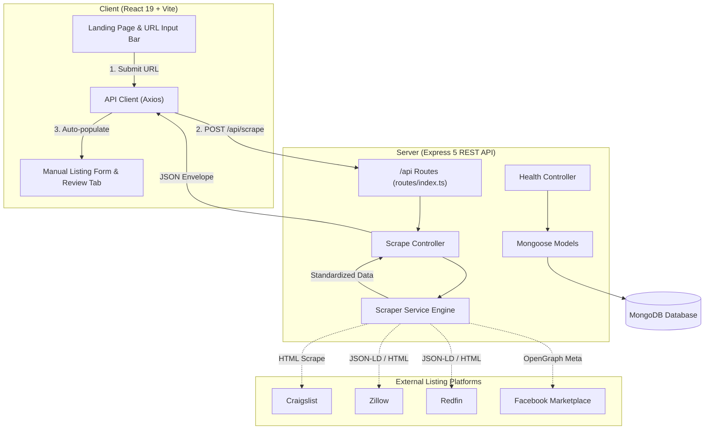

# System Architecture

This document describes the high-level architecture, module boundaries, data flows, and design invariants for the **Detect-Housing-Scam** application.



---

## 1. Directory Structure and Boundaries

The project is organized as a monorepo with distinct frontend and backend packages:

```
Detect-Housing-Scam/
├── client/                     # Frontend SPA
│   ├── src/                    # React components, pages, hooks, and styles
│   └── tests/                  # Client unit & component tests (Vitest + Testing Library)
├── server/                     # Backend API
│   ├── src/                    # Server controllers, routes, models, services
│   │   ├── config/             # DB and environment configuration
│   │   ├── controllers/        # Request handling and HTTP status codes
│   │   ├── models/             # Mongoose schemas and ODM models
│   │   ├── routes/             # Modular Express routers mounted at /api
│   │   ├── services/           # Business logic, scrapers, and external clients
│   │   ├── app.ts              # Express setup & middleware (no port binding)
│   │   └── index.ts            # Entry point: DB connection & HTTP listener
│   └── tests/                  # Server endpoint and integration tests (Vitest + Supertest)
└── docs/                       # Architectural specifications and sprint plans
    ├── architecture.md         # This system architecture guide
    ├── ci-cd.md                # CI/CD pipelines, Git hooks, and branch checks
    └── tasks/                  # CSE 115A sprint task specification files
```

---

## 2. The 3-Tier Property Scraper Pipeline

When extracting listing data from third-party links via `POST /api/scrape`, the backend uses a resilient 3-tier fallback strategy to maximize extraction accuracy while resisting anti-bot blocks:

```
                     ┌───────────────────────────────┐
                     │ Incoming URL: POST /api/scrape│
                     └───────────────┬───────────────┘
                                     │
                                     ▼
                     ┌───────────────────────────────┐
                     │ Tier 1: Dedicated HTML Parser │
                     │ (Cheerio DOM selectors)       │
                     └───────────────┬───────────────┘
                                     │ (if selectors fail or missing)
                                     ▼
                     ┌───────────────────────────────┐
                     │ Tier 2: Structured JSON-LD    │
                     │ (<script type="ld+json">)     │
                     └───────────────┬───────────────┘
                                     │ (if JSON-LD absent or blocked)
                                     ▼
                     ┌───────────────────────────────┐
                     │ Tier 3: OpenGraph & Meta Tags │
                     │ (og:title, og:image, etc.)    │
                     └───────────────┬───────────────┘
                                     │ (if unreachable or times out)
                                     ▼
                     ┌───────────────────────────────┐
                     │ Graceful Fallback             │
                     │ (HTTP 200 with success: false)│
                     └───────────────────────────────┘
```

1. **Tier 1 (Dedicated Cheerio Parsers):** Domain-specific HTML scrapers (Craigslist, Zillow, Redfin, etc.) targeting precise DOM elements to extract full photo galleries, specific rent headers, and descriptions.
2. **Tier 2 (Schema.org JSON-LD):** Extracts `<script type="application/ld+json">` data (`Accommodation`, `Apartment`, `SingleFamilyResidence`). Highly resilient against layout and CSS selector redesigns.
3. **Tier 3 (OpenGraph Meta Fallback):** Extracts `og:title`, `og:description`, and `og:image` tags. Works across social and anti-bot protected sites where DOM rendering is restricted.

---

## 3. Core Architectural Invariants

Agents and contributors must maintain the following architectural rules:

1. **Separation of Concerns:**
   - Controllers only parse requests, invoke services, and return responses.
   - Business logic, scrapers, and third-party integrations belong in `services/`.
   - Data schemas and persistence belong in `models/`.
2. **In-Memory Testability:**
   - `app.ts` must never invoke `connectDatabase()` or `app.listen()`.
   - Database connection and HTTP port listening occur strictly in `index.ts`. This allows Supertest tests to spin up `app` without live network port binding or database locks.
3. **Strict Request & Response Envelopes:**
   - Every input payload must be validated via Zod schemas.
   - API endpoints must return consistent JSON envelopes:
     - **Success:** `{ "success": true, "data": { ... } }`
     - **Error:** `{ "success": false, "error": "Message", "details": ... }`
4. **Timeouts and Fault Tolerance:**
   - All outgoing external requests (scrapers, external APIs) must specify an explicit timeout (e.g. 5000ms).
   - Downstream scrape failures or anti-bot blocks must never crash the Node.js server. The API must catch errors and return a graceful failure payload so the client can fall back to manual form entry.
5. **Testing Isolation:**
   - Unit tests in `client/tests/` and `server/tests/` must never make live external network requests.
   - External dependencies and network responses must be mocked with offline HTML/JSON fixtures.
