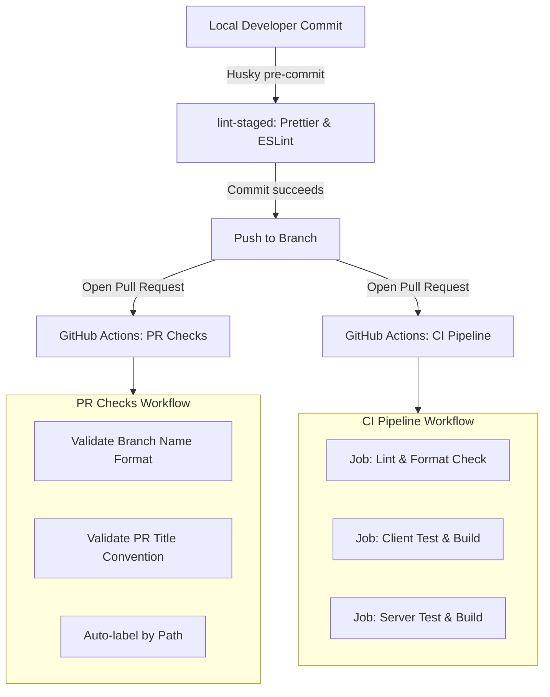

# CI/CD Pipeline and Code Quality

This document describes the automated integration and quality checks implemented for Detect-Housing-Scam.

## Overview

The quality gate system consists of two layers:

1. Local pre-commit checks managed by Husky and `lint-staged`.
2. Cloud automation managed by GitHub Actions workflows (`.github/workflows/ci.yml` and `.github/workflows/pr-checks.yml`).



## Local Git Hooks

When running `git commit`, Husky intercepts the commit and executes `.husky/pre-commit`, running `npx lint-staged`.

Target rules defined in root `package.json`:

- `client/src/**/*.{ts,tsx,js,jsx}`: Runs `prettier --write` followed by `eslint --fix`.
- `server/src/**/*.{ts,js}`: Runs `prettier --write` followed by `eslint --fix`.
- `*.{json,md,yml,yaml}`: Runs `prettier --write`.

Only staged files are processed, keeping commit times minimal.

## GitHub Actions Workflows

### 1. CI Pipeline (`.github/workflows/ci.yml`)

Triggers:

- Push to `main` or `develop`.
- Pull requests targeting `main` or `develop`.
- Manual trigger via `workflow_dispatch`.

Concurrency is enabled: pushing a new commit to an active PR automatically cancels older running CI jobs for that branch.

#### Job: Lint & Format (`lint-and-format`)

- Environment: Ubuntu Latest, Node.js 22.
- Action: Verifies formatting compliance across all client, server, and config files:
  ```bash
  npx prettier --check "client/src/**/*.{ts,tsx,js,jsx}" "server/src/**/*.{ts,js}" "*.{json,md,yml,yaml}"
  ```

#### Job: Client (`client-ci`)

- Environment: Ubuntu Latest, Node.js 22, working directory `./client`.
- Action:
  1. `npm ci`: Clean dependency installation from lockfile.
  2. `npm run lint`: Verifies ESLint rules and React hooks invariants.
  3. `npm test`: Runs Vitest unit tests.
  4. `npm run build`: Executes `tsc -b && vite build` to ensure type validity and successful production asset compilation.

#### Job: Server (`server-ci`)

- Environment: Ubuntu Latest, Node.js 22, working directory `./server`.
- Action:
  1. `npm ci`: Clean dependency installation from lockfile.
  2. `npm run lint`: Verifies server ESLint rules.
  3. `npm test`: Runs Vitest endpoint and integration tests.
  4. `npm run build`: Executes `tsc` to verify compilation into `server/dist`.

---

### 2. PR Checks & Autolabeler (`.github/workflows/pr-checks.yml`)

Triggers on pull request events (`opened`, `synchronize`, `reopened`, `edited`).

#### Branch Name Validation

Ensures the head branch follows the project format:

```regex
^(build|chore|ci|docs|feat|fix|perf|refactor|style|test)\/SCRUM-[0-9]+-[a-zA-Z0-9-]+$
```

Valid example: `feat/SCRUM-12-url-input-form`  
Invalid example: `my-fix-branch`

#### PR Title Validation

Validates that the PR title conforms to Conventional Commits:

```text
<type>(<scope>): <summary>
```

Valid example: `feat(client): add input form for link scanning`  
Valid example: `ci: add github actions pipeline`

#### Autolabeling

Labels PRs automatically based on file paths touched (e.g. `client/` changes receive the `client` label; `server/` changes receive the `server` label).

---

## Troubleshooting CI Failures

### Formatting Error in CI

If the `lint-and-format` job fails:

```bash
npx prettier --write "client/src/**/*.{ts,tsx,js,jsx}" "server/src/**/*.{ts,js}" "*.{json,md,yml,yaml}"
```

Commit and push the formatted files.

### ESLint Errors

To check and auto-fix linting issues before pushing:

```bash
npm --prefix client run lint
npm --prefix server run lint
```

### TypeScript or Build Errors

Ensure both sides compile locally:

```bash
npm --prefix client run build
npm --prefix server run build
```

### Invalid Branch Name

If the branch validation check fails on GitHub, rename your branch locally and update the remote tracking branch:

```bash
git branch -m <old-name> <new-valid-name>
git push origin -u <new-valid-name>
git push origin --delete <old-name>
```
