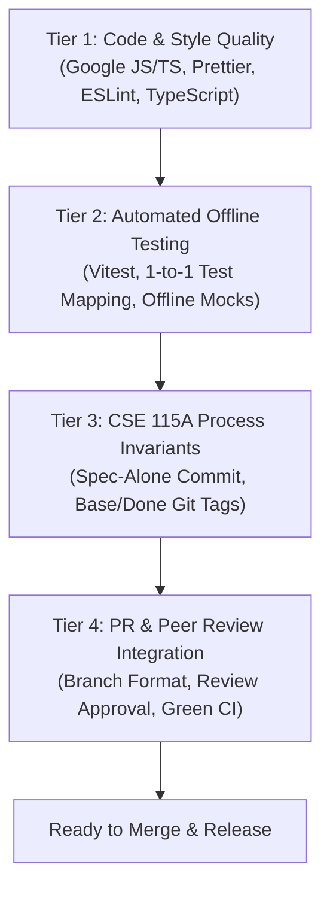

# Definition of Done (DoD)

This document establishes the official **Definition of Done (DoD)** for the **Verilet** project.

In our repository, the Definition of Done is organized into four distinct tiers:



---

## Tier 1: Code & Style Quality

Before an item can be considered complete, all code must meet repository quality standards:

1. **Google JS/TS Style Adherence:**  
   Code must comply with [docs/style-guide.md](./style-guide.md), including 2-space indentation, mandatory semicolons, single quotes, mandatory braces for all control flow, strict equality (`===`, with `== null` exception per §1.2), and no `any` types.
2. **ESLint Compliance:**  
   Code must pass ESLint with **zero warnings and zero errors**:
   ```bash
   npm --prefix client run lint
   npm --prefix server run lint
   ```
3. **Prettier Formatting:**  
   All files must be formatted cleanly according to `.prettierrc`:
   ```bash
   npx prettier --check "client/src/**/*.{ts,tsx}" "server/src/**/*.{ts}" "*.{json,md,yml}"
   ```
4. **Strict TypeScript Compilation:**  
   Code must compile with strict TypeScript checks enabled and zero type errors:
   ```bash
   npm --prefix client run build # tsc -b && vite build
   npm --prefix server run build # tsc
   ```
5. **No Dead or Unused Code:**  
   No commented-out code blocks, orphaned debug `console.log` statements, or unused imports may be committed.

---

## Tier 2: Automated Offline Testing

Quality is verified through comprehensive automated test suites:

1. **100% Offline Execution:**  
   Tests must run in complete isolation with zero live external network requests or production database connections. All HTTP calls must use local mock fixtures (Cheerio/Supertest) and database queries must use in-memory models or mocks.
2. **Test Mapping Invariant:**  
   Every numbered criterion under `## Acceptance criteria` in a task spec **must** have a dedicated, passing test with a matching description in `client/tests/` or `server/tests/`.
3. **No Test Weakening:**  
   Never weaken, bypass, or delete an existing test assertion to force code to pass.
4. **Green Test Suites:**  
   The entire test suite across client and server must pass cleanly:
   ```bash
   npm --prefix client test # Vitest client unit tests
   npm --prefix server test # Vitest server endpoint tests
   ```

---

## Tier 3: CSE 115A Sprint Task Process Points

For all graded sprint tasks submitted to the CSE 115A Repo Metrics app, developers must protect their **Process Point** by strictly following the git tagging sequence:

1. **Spec Committed Alone First:**  
   The task spec file `docs/tasks/sprint-N/<task-id>.md` **must be committed alone in the very first commit on the branch** before any implementation code or tests are created. No code or test files may be staged in that initial commit.
2. **Initial Commit Tagged (`<task-id>-base`):**  
   The initial spec-only commit must be tagged with `<task-id>-base` and pushed to the remote repository prior to committing implementation code.
3. **Single Task Spec Invariant:**  
   Within `docs/tasks/`, the pull request must modify **exactly one file**: `docs/tasks/sprint-N/<task-id>.md`.
4. **Merge Commit Tagged (`<task-id>-done`):**  
   After the pull request is merged into `main`, the merge commit on `main` must be tagged with `<task-id>-done` and pushed to origin.
5. **Repo Metrics Submission:**  
   The merged PR URL must be submitted to the corresponding task card on the Repo Metrics app.

---

## Tier 4: PR & Peer Review Integration

Before merging into `main`, code must clear our team integration gates:

1. **Branch Naming Compliance:**  
   The branch must follow one of the two accepted patterns:
   - Team Infrastructure: `<type>/SCRUM-<number>-<short-description>`
   - CSE 115A Sprint Task: `task/<task-id>`
2. **Commit Message Format:**  
   All commit messages must adhere to Conventional Commits or the task spec format (`<task-id>: <summary>`).
3. **PR Template Completed:**  
   The pull request description must outline the problem addressed, changes introduced, and testing evidence.
4. **Peer Review Approval:**  
   The PR must receive an official approval from at least **one team member** after code review.
5. **Continuous Integration (CI) Green:**  
   All automated checks on GitHub Actions (Lint & Format, Client CI, Server CI, PR Checks) must pass.
6. **No Merge Conflicts:**  
   The branch must be merged with `main` with zero merge conflicts.

---

## Summary Checklist

Use this quick checklist before requesting a final PR merge:

| Verification Item       | Requirement                                                       | Checked |
| :---------------------- | :---------------------------------------------------------------- | :-----: |
| **Google Style**        | Prettier and ESLint pass with zero errors.                        |   [ ]   |
| **Strict TypeScript**   | `npm run build` succeeds on client and server.                    |   [ ]   |
| **Offline Tests**       | `npm test` passes with offline fixtures and no live dependencies. |   [ ]   |
| **Test Mapping**        | Every numbered acceptance criterion has a dedicated passing test. |   [ ]   |
| **Initial Spec Commit** | Spec was committed alone and tagged `<task-id>-base`.             |   [ ]   |
| **Single Spec Touched** | Only one markdown file modified under `docs/tasks/`.              |   [ ]   |
| **Peer Review**         | Approved by at least one teammate.                                |   [ ]   |
| **CI Checks**           | All GitHub Actions jobs are green.                                |   [ ]   |
| **Done Tag**            | Merge commit tagged `<task-id>-done` and pushed.                  |   [ ]   |
