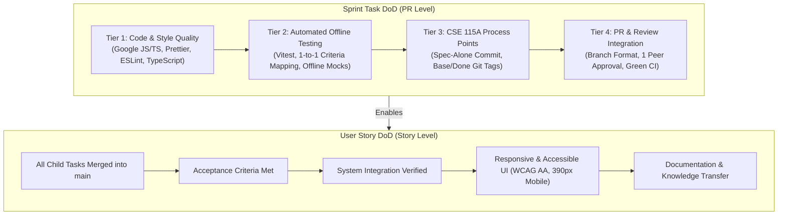

# Definition of Done (DoD)

This document establishes the official **Definition of Done (DoD)** for the **Verilet** project.

To ensure both technical excellence and delivered user value, our Definition of Done operates across two complementary scopes:

1. **Sprint Task DoD (Developer / Technical Unit):** Verified on every individual task pull request before merging into `main`.
2. **User Story DoD (Business / Feature Unit):** Verified when all constituent tasks are integrated and the feature is ready for end users and sprint demo.



---

## Part 1: Sprint Task Definition of Done

Every technical sprint task (e.g., `SCRUM-20-T-2`, `US-1-T-1`) must satisfy all tiers before its pull request can be merged into `main`.

### Tier 1: Code & Style Quality

1. **Google JS/TS Style Adherence:**  
   Code must comply with [docs/style-guide.md](./style-guide.md), including 2-space indentation, mandatory semicolons, single quotes, mandatory braces for all control flow, strict equality (`===`, with `== null` exception per §1.2), and no `any` types.
2. **ESLint Compliance:**  
   Code must pass ESLint with **zero warnings and zero errors**:
   ```bash
   npm --prefix client run lint
   npm --prefix server run lint
   ```
3. **Prettier Formatting:**  
   All files must be formatted cleanly according to `.prettierrc`:
   ```bash
   npm run format:check
   ```
4. **Strict TypeScript Compilation:**  
   Code must compile with strict TypeScript checks enabled and zero type errors:
   ```bash
   npm --prefix client run build # tsc -b && vite build
   npm --prefix server run build # tsc
   ```
5. **No Dead or Unused Code:**  
   No commented-out code blocks, orphaned debug `console.log` statements, or unused imports may be committed.

---

### Tier 2: Automated Offline Testing

1. **100% Offline Execution:**  
   Tests must run in complete isolation with zero live external network requests or production database connections. All HTTP calls must use local mock fixtures (Cheerio/Supertest) and database queries must use in-memory models or mocks.
2. **Direct Test Mapping Invariant:**  
   Every numbered criterion under `## Acceptance criteria` in the task spec **must** have a dedicated, passing test assertion with a matching identifier (e.g. `it('[Criterion N] ...')`) in `client/tests/` or `server/tests/`.
3. **Unit Test Style Compliance:**  
   Test files and test cases must follow the naming conventions in [docs/style-guide.md §3.2](./style-guide.md#32-unit-test-naming-conventions).
4. **No Test Weakening:**  
   Never weaken, bypass, or delete an existing test assertion to force code to pass.
5. **Green Test Suites:**  
   The entire test suite across client and server must pass cleanly:
   ```bash
   npm --prefix client test # Vitest client unit tests
   npm --prefix server test # Vitest server endpoint tests
   ```

---

### Tier 3: CSE 115A Sprint Task Process Points

For all graded sprint tasks submitted to the CSE 115A Repo Metrics app, developers must protect their **Process Point** by strictly following the git tagging sequence:

1. **Spec Committed Alone First:**  
   The task spec file `docs/tasks/sprint-N/<task-id>.md` **must be committed alone in the very first commit on the branch** before any implementation code or tests are created. No code or test files may be staged in that initial commit.
2. **Initial Commit Tagged (`<task-id>-base`):**  
   The initial spec-only commit must be tagged with `<task-id>-base` and pushed to the remote repository prior to committing implementation code.
3. **Comprehensive Implementation Scope:**  
   A task PR is expected to touch all necessary implementation files required to fulfill its criteria (e.g., services, routes, schemas, controllers, frontend views, tests, and task documentation). PRs are not restricted to touching only a single file.
4. **Merge Commit Tagged (`<task-id>-done`):**  
   After the pull request is merged into `main`, the merge commit on `main` must be tagged with `<task-id>-done` and pushed to origin.
5. **Repo Metrics Submission:**  
   The merged PR URL must be submitted to the corresponding task card on the Repo Metrics app.

---

### Tier 4: PR & Peer Review Integration

Before merging into `main`, code must clear our team integration gates:

1. **Branch Naming Compliance:**  
   The branch must follow one of the two accepted patterns:
   - Team Infrastructure: `<type>/SCRUM-<number>-<short-description>`
   - CSE 115A Sprint Task: `task/<task-id>`
2. **Commit Message Format:**  
   All commit messages must adhere to Conventional Commits or the task spec format (`<task-id>: <summary>`).
3. **PR Template Completed:**  
   The pull request description must outline the problem addressed, changes introduced, and testing evidence.
4. **Peer Review Approval:**  
   The PR must receive an official approval from at least **one team member** after code review.
5. **Continuous Integration (CI) Green:**  
   All automated checks on GitHub Actions (Lint & Format, Client CI, Server CI, PR Checks) must pass.
6. **No Merge Conflicts:**  
   The branch must be merged with `main` with zero merge conflicts.

---

## Part 2: User Story Definition of Done

A parent User Story tracked in Jira is considered **Done** only when all child sprint tasks have merged and the integrated feature meets the following business criteria:

1. **All Child Tasks Merged:**  
   All constituent sprint tasks that decompose the user story have completed their Sprint Task DoD and are successfully merged into `main`.
2. **Acceptance Criteria Verified:**  
   All acceptance criteria specified in the Jira User Story are verified end-to-end in the integrated application.
3. **System Integration:**  
   The feature functions seamlessly across the full stack (frontend UI to backend APIs and persistence) without requiring mock bypasses or hardcoded test overrides in production builds.
4. **Responsive & Accessible UI:**
   - The user interface renders correctly on desktop and mobile viewports down to **390px** without unintended horizontal overflow.
   - All interactive elements meet WCAG 2.1 AA accessibility standards.
5. **Demo-Ready:**  
   The story can be demonstrated live during Sprint Review with real sample rental listings and standard scam scenarios.
6. **Documentation Updated:**  
   Architecture diagrams, user documentation, and API specifications are updated to reflect the new capabilities.

---

## Summary Checklists

### Sprint Task Completion Checklist (PR Level)

| Verification Item       | Requirement                                                       | Checked |
| :---------------------- | :---------------------------------------------------------------- | :-----: |
| **Google Style**        | Prettier and ESLint pass with zero errors.                        |   [ ]   |
| **Strict TypeScript**   | `npm run build` succeeds on client and server.                    |   [ ]   |
| **Offline Tests**       | `npm test` passes with offline fixtures and no live dependencies. |   [ ]   |
| **Test Mapping**        | Every numbered criterion has a dedicated test (`[Criterion N]`).  |   [ ]   |
| **Initial Spec Commit** | Spec was committed alone and tagged `<task-id>-base`.             |   [ ]   |
| **All Files Included**  | All necessary services, schemas, and tests are cleanly included.  |   [ ]   |
| **Peer Review**         | Approved by at least one teammate.                                |   [ ]   |
| **CI Checks**           | All GitHub Actions jobs are green.                                |   [ ]   |
| **Done Tag**            | Merge commit tagged `<task-id>-done` and pushed.                  |   [ ]   |

### User Story Completion Checklist (Jira Level)

| Verification Item           | Requirement                                                     | Checked |
| :-------------------------- | :-------------------------------------------------------------- | :-----: |
| **All Tasks Merged**        | Every child sprint task PR is merged into `main`.               |   [ ]   |
| **Criteria Met**            | All story criteria pass in integrated flows.                    |   [ ]   |
| **Responsive Design**       | Tested cleanly down to 390px mobile viewport with no overflow.  |   [ ]   |
| **Accessibility (WCAG AA)** | Contrast, keyboard navigation, and reduced-motion compliant.    |   [ ]   |
| **Demo Readiness**          | Story is prepared and validated for Sprint Review demo.         |   [ ]   |
| **Documentation**           | Architecture and specs updated to reflect new feature behavior. |   [ ]   |
