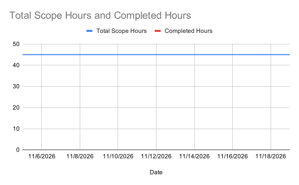

# Sprint 3 Plan

- **Document Name:** Sprint 3 Plan
- **Product Name:** Verilet
- **Team Name:** Verilet
- **Sprint Completion Date:** November 19, 2026
- **Revision Number:** Revision 1.2
- **Revision Date:** November 11, 2026

---

## Goal

Provide student renters with an automated listing scan that extracts property details from a pasted link directly into an autofilled verification form, while actively alerting them to illegal security deposits, excessive application fees, phantom addresses, and high-risk payment terms.

---

## Task Listing, Organized by User Story

_User stories and items from the Jira backlog (Sprint 3: 5 Nov – 19 Nov) are listed in priority order from most important (top) to least important (bottom). Every task includes an estimated effort of $\le 6$ ideal hours._

### User story 1 ("As a student, I want to paste a listing link so that I don't have to spend time typing out information by hand.")

- **Jira Issue Key:** `SCRUM-3`
- **Priority Rating:** 1 (Highest)
- **Story Points:** 8
- **Assignee:** Aubrey Hayes
- **Sprint 2 Completed Tasks:** `SCRUM-3-T-1` (Scrape endpoint & JSON-LD parser · 4h) and `SCRUM-3-T-2` (Dedicated Craigslist scraper · 6h)
- **Sprint 3 Remaining Sub-tasks:**
  1. Build frontend URL search bar component with active loading spinner, client-side URL validation, and invalid URL alert banner (`SCRUM-3-T-3`) (5 ideal hours)
  2. Connect scraper response handler to auto-populate form inputs, switch to the manual form tab, and display an inline review prompt (`SCRUM-3-T-4`) (5 ideal hours)

**Total for user story 1:** 10 ideal hours

---

### User story 2 ("As a student, I want to fill out a simple form about a rental listing, so I can check if it's a scam.")

- **Jira Issue Key:** `SCRUM-15`
- **Priority Rating:** 1 (Highest)
- **Story Points:** 8
- **Assignee:** Devarsh Krishnan Jayakrishnan
- **Status:** Core form inputs implemented in Sprint 2; in PR review
- **Sprint 3 Remaining Sub-tasks:**
  1. Finalize PR review revisions, input validation edge-cases, and merge manual listing form to receive scraper autofill (`SCRUM-15-T-1`) (0 ideal hours — implementation hours credited in Sprint 2)

**Total for user story 2:** 0 ideal hours

---

### User story 3 ("As a student, I want illegal deposits and excessive fees automatically flagged, so that I can avoid predatory rental scams.")

- **Jira Issue Key:** `SCRUM-21`
- **Priority Rating:** 2
- **Assignee:** Aubrey Hayes
- **Sprint 3 Sub-tasks:**
  1. Create `securityDeposit.service.ts` with Zod schema, California AB 12 deposit cap evaluation, standardized result envelope, and unit tests in `server/tests/securityDeposit.test.ts` (`SCRUM-21-T-1`) (4 ideal hours)
  2. Create `applicationFee.service.ts` with Zod schema, California Civil Code § 1950.6 $65 statutory fee limit check, standardized result envelope, and unit tests in `server/tests/applicationFee.test.ts` (`SCRUM-21-T-2`) (4 ideal hours)

**Total for user story 3:** 8 ideal hours

---

### User story 4 ("As a student renter, I want to confirm that a property really exists and is a genuine residential home, so that I don't waste time or deposit money on scams.")

- **Jira Issue Key:** `SCRUM-20`
- **Priority Rating:** 2
- **Story Points:** 5
- **Assignee:** Adan Magaña-Bravo
- **Sprint 3 Sub-tasks:**
  1. Create `gisLandUse.service.ts` with `GisAddressInputSchema` and Santa Cruz County Assessor MapServer ArcGIS REST query builder with normalized address matching and 5000ms timeout handling (`SCRUM-20-T-1`) (4 ideal hours)
  2. Implement assessor `USECDDESC` land use code evaluation, non-residential/unverified flag triggers, standardized JSON envelope, and offline Vitest tests with mocked parcel fixtures (`SCRUM-20-T-2`) (4 ideal hours)

**Total for user story 4:** 8 ideal hours

---

### User story 5 ("As a student, I want the system to alert me if the lister asks for high-risk payment methods so that I don't send money through unsafe methods.")

- **Jira Issue Key:** `SCRUM-18`
- **Priority Rating:** 3
- **Story Points:** 5
- **Assignee:** Lars Voigt-Bui
- **Sprint 2 Completed Tasks:** `SCRUM-18-T-1` (Regex crypto, wire transfer, and gift card scanner · 6h)
- **Sprint 3 Remaining Sub-tasks:**
  1. Build proximity regex detecting P2P cash apps (Zelle, Venmo, CashApp, Chime) paired with advance deposit terms (before tour, holding fee) (`SCRUM-18-T-2`) (6 ideal hours)

**Total for user story 5:** 6 ideal hours

---

### User story 6 ("As a student, I want to be told if the listing is greatly below the average rental price so that I don't fall for a listing that's too good to be true.")

- **Jira Issue Key:** `SCRUM-19`
- **Priority Rating:** 3
- **Story Points:** 5
- **Assignee:** Yifei Peng
- **Sprint 2 Completed Tasks:** `SCRUM-19-T-2` (HUD Fair Market Rent benchmark tables · 5h)
- **Sprint 3 Remaining Sub-tasks:**
  1. Implement `price.checker.ts` outlier comparison service comparing listing rent against Santa Cruz median rent thresholds (`SCRUM-19-T-1`) (6 ideal hours)
  2. Set up test MongoDB Atlas replica cluster and write backend Vitest tests verifying median comparisons, room adjustments, and boundary thresholds (`SCRUM-19-T-3`) (2 ideal hours)

**Total for user story 6:** 8 ideal hours

---

### User story 7 ("As a student, I want a short explanation of how Verilet works, so I know what to enter and what my result means.")

- **Jira Issue Key:** `SCRUM-48`
- **Priority Rating:** 4
- **Assignee:** Devarsh Krishnan Jayakrishnan
- **Sprint 2 Completed Tasks:** Check page 3-step explanation layout & wireframes
- **Sprint 3 Remaining Sub-tasks:**
  1. Build interactive road-style "How it works" animated visualization route (`/how-it-works`) explaining the 4-tier verification process (`SCRUM-48-T-8`) (5 ideal hours)

**Total for user story 7:** 5 ideal hours

---

### Total Planned Sprint Effort

- **Sprint 2 Carried-Over Scope:** 29.0 ideal work hours across 5 stories (`SCRUM-3-T-3` [5h], `SCRUM-3-T-4` [5h], `SCRUM-18-T-2` [6h], `SCRUM-19-T-1` [6h], `SCRUM-19-T-3` [2h], `SCRUM-48-T-8` [5h])
- **New Stories Scope:** 16.0 ideal work hours (`SCRUM-21-T-1` [4h], `SCRUM-21-T-2` [4h], `SCRUM-20-T-1` [4h], `SCRUM-20-T-2` [4h])
- **Total Planned Sprint 3 Scope:** **45.0 ideal work hours** across 7 user stories (10 discrete technical tasks)
- **Average Task Size:** 4.50 ideal hours per task (all $\le 6$ hours)

---

## Team Roles

- Aubrey Hayes: Developer, Scrum Master
- Yifei Peng: Developer, Product Owner
- Lars Voigt-Bui: Developer
- Devarsh Krishnan Jayakrishnan: Developer
- Adan Magaña-Bravo: Developer

---

## Initial Task Assignment

- **Aubrey Hayes:** User Story 1 (`SCRUM-3`: "As a student, I want to paste a listing link..."), Initial Task: Build frontend URL search bar component with active loading spinner and client-side URL validation (`SCRUM-3-T-3`)
- **Adan Magaña-Bravo:** User Story 4 (`SCRUM-20`: "As a student renter, I want to confirm that a property really exists..."), Initial Task: Create Santa Cruz County Assessor MapServer query builder and address normalization (`SCRUM-20-T-1`)
- **Lars Voigt-Bui:** User Story 5 (`SCRUM-18`: "As a student, I want the system to alert me if the lister asks for high-risk payment methods..."), Initial Task: Build proximity regex detecting P2P cash apps paired with advance deposit terms (`SCRUM-18-T-2`)
- **Yifei Peng:** User Story 6 (`SCRUM-19`: "As a student, I want to be told if the listing is greatly below the average rental price..."), Initial Task: Implement price outlier comparison service comparing listing rent against Santa Cruz median rent thresholds (`SCRUM-19-T-1`)
- **Devarsh Krishnan Jayakrishnan:** User Story 7 (`SCRUM-48`: "As a student, I want a short explanation of how Verilet works..."), Initial Task: Build interactive road-style "How it works" animated visualization route (`SCRUM-48-T-8`)

---

## Initial Burnup Chart

- **Document Name / Chart Label:** Sprint 3 Initial Burnup Chart - Project Verilet
- **Hosting & Location:** The initial burnup chart is hosted in Google Sheets (accessible to team members and course staff) and tracks daily progress toward sprint completion. The initial baseline chart is embedded above and archived in the repository at `docs/sprint-review/assets/sprint_3_initial_burnup.svg`.
- **Baseline Scope:** Plotted at 45.0 total ideal work hours across 14 sprint days (November 5 – November 19, 2026), starting at Day 0 with 0 completed hours and a planned completion trajectory averaging ~3.2 ideal hours/day across the 5-person team.

---

## Initial Scrum Board

The team manages its Scrum board exclusively and digitally via Jira at:  
[**Jira Scrum Board (Project SCRUM, Board 1)**](https://slugsafe.atlassian.net/jira/software/projects/SCRUM/boards/1) (access provided to teaching staff and TA).

The digital board is organized into standard Jira workflow columns (**To Do**, **In Progress**, **In Review**, and **Done**), with subtasks mapped directly to their parent work items:

| Jira Key       | Work Item / User Story Summary                              | Tasks Not Started (To Do)                                                               | Tasks in Progress                                                       | Status at Sprint Kickoff |
| :------------- | :---------------------------------------------------------- | :-------------------------------------------------------------------------------------- | :---------------------------------------------------------------------- | :----------------------- |
| **`SCRUM-3`**  | Paste listing link to extract details (8 pts · Aubrey)      | `SCRUM-3-T-4`: Scraper form redirect & review prompt (5h)                               | `SCRUM-3-T-3`: URL input bar & validation spinner (5h · Aubrey)         | To Do / Active           |
| **`SCRUM-15`** | Fill out simple listing form (8 pts · Devarsh)              | _(None)_                                                                                | `SCRUM-15-T-1`: Form PR review revisions & merge (Devarsh)              | In Review                |
| **`SCRUM-21`** | Flag illegal security deposits & fees (Aubrey)              | `SCRUM-21-T-1`: AB 12 deposit service (4h) `SCRUM-21-T-2`: § 1950.6 fee service (4h) | _(Queued for immediate pickup)_                                         | To Do / Ready            |
| **`SCRUM-20`** | Confirm property exists & residential zoning (5 pts · Adan) | `SCRUM-20-T-2`: Zoning use code evaluation & offline tests (4h)                         | `SCRUM-20-T-1`: Santa Cruz MapServer ArcGIS query builder (4h · Adan)   | In Progress              |
| **`SCRUM-18`** | High-risk payment method alerts (5 pts · Lars)              | _(None)_                                                                                | `SCRUM-18-T-2`: P2P advance deposit proximity regex (6h · Lars)         | In Progress              |
| **`SCRUM-19`** | Below-market price outlier alert (5 pts · Yifei)            | `SCRUM-19-T-3`: MongoDB Atlas test DB & boundary tests (2h)                             | `SCRUM-19-T-1`: Santa Cruz rent outlier comparison service (6h · Yifei) | In Progress              |
| **`SCRUM-48`** | Short explanation of how Verilet works (Devarsh)            | _(None)_                                                                                | `SCRUM-48-T-8`: Road-style animated walkthrough route (5h · Devarsh)    | In Progress              |

---

## Scrum Times

The team conducts three scheduled Scrum meetings each week:

1. **Monday at 4:30 PM – 5:30 PM** (Online)  
   **TA/Tutor Visit Meeting:** As arranged with the course teaching staff, this extended session includes the TA/tutor visit and review.
2. **Wednesday at 6:00 PM – 6:15 PM** (Online stand-up via Discord)
3. **Friday at 6:00 PM – 6:15 PM** (Online stand-up via Discord)

---

## Release Plan Status

The team reviewed the project Release Plan during Sprint 3 planning. The planned tasks and scope remain fully consistent with our target MVP release scheduled for the end of Sprint 4. No modifications to the Release Plan were required.
