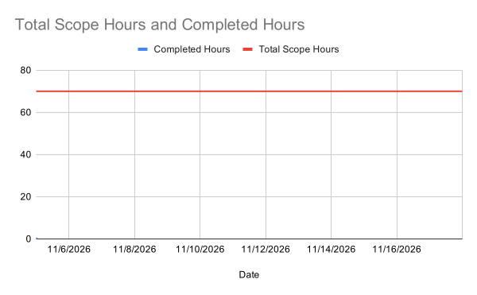

# Sprint 4 Plan

- **Document Name:** Sprint 4 Plan
- **Product Name:** Verilet
- **Team Name:** Verilet
- **Sprint Completion Date:** December 1, 2026
- **Revision Number:** Revision 1.0
- **Revision Date:** November 20, 2026

---

## Goal

Deliver Verilet's final MVP release by implementing cross-platform duplicate listing detection, suspicious contact number identification, legitimate rental company/agency business registry verification, a comprehensive deterministic risk scoring api, user account creation and authentication via Clerk, saved scan history, and one-click clipboard scan sharing.

---

## Task Listing, Organized by User Story

_User stories and work items from the Jira backlog (Sprint 4: 19 Nov – 1 Dec) are listed in priority order from most important (top) to least important (bottom). Every task represents a discrete technical work unit._

### User story 1 ("As a student, I want to see a risk rating of the listing I care about.")

- **Jira Issue Key:** `SCRUM-70`
- **Priority Rating:** 1
- **Story Points:** 8
- **Assignee:** Aubrey Hayes (`SCRUM-70-T-1`)
- **Status:** In Progress
- **Sprint 4 Tasks:**
  1. Backend evaluation orchestrator and worker concurrency manager (`SCRUM-70-T-1` · Jira `SCRUM-73`) (4 ideal hours · Aubrey Hayes)
  2. Deterministic scoring engine with weighted risk factors and insufficient data handling (`SCRUM-70-T-2` · Jira `SCRUM-74`) (4 ideal hours)
  3. Frontend client integration, scan loading state, and comprehensive results breakdown (`SCRUM-70-T-3` · Jira `SCRUM-75`) (4 ideal hours)

**Total for user story 1:** 12 ideal hours

---

### User story 2 ("As a user, I want to create an account so that I can securely log in, access my saved rental scans, and manage my checked listings across sessions.")

- **Jira Issue Key:** `SCRUM-68`
- **Priority Rating:** 2
- **Story Points:** 5
- **Assignee:** Devarsh Krishnan Jayakrishnan
- **Status:** In Review
- **Sprint 4 Tasks:**
  1. Client-Side Authentication Shell, Branded Clerk Views & Saved Scans View (`SCRUM-68-T-1` · Jira `SCRUM-78` / `SCRUM-77`) (8 ideal hours)
     - Implement client-side authentication shell using `@clerk/react`, branded login/signup views (`client/src/views/AuthView.tsx`), and auth session management/route protection (`client/src/auth/authState.ts`, `client/src/auth/AuthProvider.tsx`, `client/src/auth/ClerkAuth.tsx`).
     - Build dynamic site navigation header with user profile menu (`client/src/components/Header.tsx`), signed-in home dashboard (`client/src/views/HomeView.tsx`), past scans history table with risk filters (`client/src/views/ScansView.tsx`), and one-click summary clipboard sharing (`client/src/lib/share.ts`).

**Total for user story 2:** 8 ideal hours

---

### User story 3 ("As a student, I want to save the results of my scans to look at later.")

- **Jira Issue Key:** `SCRUM-69`
- **Priority Rating:** 2
- **Story Points:** 5
- **Assignee:** Devarsh Krishnan Jayakrishnan
- **Status:** In Review
- **Sprint 4 Tasks:**
  1. Backend Scan Persistence Service, Database Model & User Retrieval API (`SCRUM-69-T-1`) (6 ideal hours)
     - Implement backend scan persistence service (`server/src/services/scanPersistence.service.ts`), MongoDB saved-scans schema and index model (`server/src/models/savedScan.model.ts`), and authenticated scan retrieval API endpoints (`server/src/routes/scans.routes.ts`) mounted at `/api/scans`.
     - Associate saved scans with verified Clerk user IDs, ensuring secure multi-tenant isolation, query sorting by timestamp, and offline Vitest validation.

**Total for user story 3:** 6 ideal hours

---

### User story 4 ("As a student, I want to know if the provided contact information is suspicious.")

- **Jira Issue Key:** `SCRUM-16`
- **Priority Rating:** 3
- **Story Points:** 5
- **Assignee:** Adan Magaña-Bravo (`SCRUM-16-T-1`)
- **Status:** In Progress
- **Sprint 4 Tasks:**
  1. Build phone normalization and area code risk classification (`SCRUM-16-T-1` · Jira `SCRUM-71`) (6 ideal hours · Adan Magaña-Bravo)
  2. Detect obfuscated contact numbers in listing descriptions (`SCRUM-16-T-2` · Jira `SCRUM-72`) (5 ideal hours)

**Total for user story 4:** 11 ideal hours

---

### User story 5 ("As a student renter, I want to verify that a rental company or property management agency is an officially registered business, so that I don't send money or personal details to a fake entity.")

- **Jira Issue Key:** `SCRUM-17`
- **Priority Rating:** 3
- **Story Points:** 5
- **Assignee:** Unassigned
- **Status:** To Do
- **Sprint 4 Tasks:**
  1. OpenCorporates API Client, Timeout Handling, and Entity Caching (`SCRUM-17-T-1`) (4 ideal hours)
     - Build OpenCorporates API client service (`server/src/services/openCorporatesClient.service.ts`) with an explicit 5000ms `AbortSignal` timeout, API key authorization from `process.env.OPENCORPORATES_API_KEY`, and a lightweight in-memory cache to conserve the 500-request/month free tier quota.
     - Prevent CI and local development breakages by implementing graceful fallback: if `OPENCORPORATES_API_KEY` is missing, rate-limited (HTTP 429), or times out, degrade cleanly to `status: "skipped"` with an explanatory message rather than throwing errors.
  2. Agency Verification Evaluator & Corporate Indicator Heuristics (`SCRUM-17-T-2`) (4 ideal hours)
     - Build agency verification evaluator (`server/src/services/agencyVerification.service.ts`) that pre-filters landlord names using corporate indicators (`LLC`, `Inc`, `Corp`, `Properties`, `Property Management`, `Realty`, `Real Estate`, `Rentals`, `Group`, `Holdings`, `Apartments`) and evaluates legal standing against California business registry records.
     - Automatically evaluate private individual landlords (e.g., "John Doe") and unlisted landlord inputs as `status: "skipped"` with `flag: null` without dispatching outgoing API requests.
     - Prevent false positives from apartment community trade names (DBAs): treat zero registry records as an unverified/warning state rather than throwing unhandled exceptions.

**Total for user story 5:** 8 ideal hours

---

### User story 6 ("As a student, I want to know if the housing is being listed elsewhere.")

- **Jira Issue Key:** `SCRUM-64`
- **Priority Rating:** 3
- **Story Points:** 5
- **Assignee:** Yifei Peng
- **Status:** In Progress
- **Sprint 4 Tasks:**
  1. Build new listing scrapers for platforms other than Craigslist (`SCRUM-64-T-1` · Jira `SCRUM-65`) (2 ideal hours · Yifei Peng)
  2. Implement cross-listing comparison engine and duplicate fraud flagging (`SCRUM-64-T-2` · Jira `SCRUM-66`) (6 ideal hours)
  3. Add contact field extraction and parsing to dedicated Craigslist scraper (`SCRUM-64-T-3` · Jira `SCRUM-67`) (6 ideal hours)

**Total for user story 6:** 14 ideal hours

---

### User story 7 ("As a student, I want the system to alert me if the lister asks for high-risk payment methods so that I don't send money through unsafe methods.")

- **Jira Issue Key:** `SCRUM-18`
- **Priority Rating:** 3
- **Story Points:** 5
- **Assignee:** Lars Voigt-Bui
- **Status:** In Progress
- **Sprint 3 Completed Tasks:** `SCRUM-18-T-1` (Flag untraceable payment terms · 6h)
- **Sprint 4 Remaining Tasks:**
  1. Build proximity regex detecting P2P cash apps (Zelle, Venmo, CashApp, Chime) paired with advance deposit terms (`SCRUM-18-T-2` · Jira `SCRUM-37`) (6 ideal hours · Lars Voigt-Bui)

**Total for user story 7:** 6 ideal hours

---

### User story 8 ("As a student, I want to share the result of my scan with others.")

- **Jira Issue Key:** `SCRUM-24`
- **Priority Rating:** 4 (Low)
- **Story Points:** 3
- **Assignee:** Unassigned
- **Status:** To Do
- **Sprint 4 Tasks:**
  1. Implement one-click summary clipboard sharing, standardized text summary generator, and accessible live region announcements (`SCRUM-24-T-1` · Jira `SCRUM-76`) (5 ideal hours)

**Total for user story 8:** 5 ideal hours

---

### Total Planned Sprint Effort

- **Sprint 3 Carried-Over Scope:** 6.0 ideal work hours across 1 story (`SCRUM-18-T-2` [6h])
- **New Stories Scope:** 64.0 ideal work hours across 7 stories (`SCRUM-70` [12h], `SCRUM-68` [8h], `SCRUM-69` [6h], `SCRUM-16` [11h], `SCRUM-17` [8h], `SCRUM-64` [14h], `SCRUM-24` [5h])
- **Total Planned Sprint 4 Scope:** **70.0 ideal work hours** across 8 user stories (14 discrete technical tasks)
- **Average Task Size:** 5.00 ideal hours per task

---

## Team Roles

- Aubrey Hayes: Developer
- Yifei Peng: Developer, Product Owner
- Lars Voigt-Bui: Developer
- Devarsh Krishnan Jayakrishnan: Developer
- Adan Magaña-Bravo: Developer, Scrum Master

---

## Initial Task Assignment

- **Aubrey Hayes:** User Story 1 (`SCRUM-70`: "As student, I want to see a risk rating of the listing I care about"), Initial Task: Backend evaluation orchestrator and worker concurrency manager (`SCRUM-70-T-1` · Jira `SCRUM-73` · 4h) [in addition to concluding Sprint 3 review & Sprint 4 plan documentation on `SCRUM-22-T-1`]
- **Adan Magaña-Bravo:** User Story 4 (`SCRUM-16`: "As a student, I want to know if the provided contact information is suspicious..."), Initial Task: Build phone normalization and area code risk classification (`SCRUM-16-T-1` · Jira `SCRUM-71` · 6h)
- **Yifei Peng:** User Story 6 (`SCRUM-64`: "As a student, I want to know if the housing is being listed elsewhere..."), Initial Task: Build new listing scrapers for platforms other than Craigslist (`SCRUM-64-T-1` · Jira `SCRUM-65` · 2h)
- **Lars Voigt-Bui:** User Story 7 (`SCRUM-18`: "As a student, I want the system to alert me if the lister asks for high-risk payment methods..."), Initial Task: Build proximity regex detecting P2P cash apps paired with advance deposit terms (`SCRUM-18-T-2` · Jira `SCRUM-37` · 6h)
- **Devarsh Krishnan Jayakrishnan:** User Story 2 (`SCRUM-68`: "As a user, I want to create an account..."), Initial Task: Client-side authentication shell, branded Clerk views & saved scans view (`SCRUM-68-T-1` · Jira `SCRUM-78` / `SCRUM-77` · 8h)

---

## Initial Burnup Chart

- **Document Name / Chart Label:** Sprint 4 Initial Burnup Chart - Project Verilet
- **Hosting & Location:** The initial burnup chart is hosted in Google Sheets and tracks progress toward final MVP completion. The initial baseline chart is embedded above and archived in the repository at `docs/assets/sprint_4_initial_burnup.svg`.
- **Baseline Scope:** Plotted at 70.0 total ideal work hours across 13 sprint days (November 19 – December 1, 2026), starting at Day 0 with 0 completed hours and a planned completion trajectory averaging ~5.4 ideal hours/day across the 5-person team.

---

## Initial Scrum Board

The team manages its Scrum board exclusively and digitally via Jira at:  
[**Jira Scrum Board (Project SCRUM, Board 1)**](https://slugsafe.atlassian.net/jira/software/projects/SCRUM/boards/1).

The digital board is organized into standard Jira workflow columns (**To Do**, **In Progress**, **In Review**, and **Done**), with tasks mapped directly to their parent work items:

| Jira Key       | Work Item / User Story Summary                                 | Tasks Not Started (To Do)                                                                                              | Tasks in Progress                                                     | Status at Sprint Kickoff |
| :------------- | :------------------------------------------------------------- | :--------------------------------------------------------------------------------------------------------------------- | :-------------------------------------------------------------------- | :----------------------- |
| **`SCRUM-70`** | Comprehensive risk rating & scoring engine (8 pts · Aubrey)    | `SCRUM-70-T-2`: Deterministic scoring engine (4h) `SCRUM-70-T-3`: Frontend client integration & breakdown view (4h) | `SCRUM-70-T-1`: Backend evaluation orchestrator (4h · Aubrey)         | In Progress              |
| **`SCRUM-68`** | User account creation via Clerk (5 pts · Devarsh)              | _(None)_                                                                                                               | `SCRUM-68-T-1`: Clerk auth shell, views & header (8h · Devarsh)       | In Review                |
| **`SCRUM-69`** | Save and view scan results (5 pts · Devarsh)                   | _(None)_                                                                                                               | `SCRUM-69-T-1`: Backend scan persistence & history API (6h · Devarsh) | In Review                |
| **`SCRUM-16`** | Contact information verification (5 pts · Adan)                | `SCRUM-16-T-2`: Obfuscated contact detection (5h)                                                                      | `SCRUM-16-T-1`: Phone normalization (6h · Adan)                       | In Progress              |
| **`SCRUM-17`** | Registered agency & business verification (5 pts · Unassigned) | `SCRUM-17-T-1`: OpenCorporates API client & cache (4h) `SCRUM-17-T-2`: Agency verification evaluator (4h)           | _(Queued for pickup · Unassigned)_                                    | To Do / Ready            |
| **`SCRUM-64`** | Cross-platform duplicate listing detection (5 pts · Yifei)     | `SCRUM-64-T-2`: Duplicate comparison engine (6h) `SCRUM-64-T-3`: Craigslist contact extraction (6h)                 | `SCRUM-64-T-1`: New scrapers for other sites (2h · Yifei)             | In Progress              |
| **`SCRUM-18`** | High-risk payment method alerts (5 pts · Lars)                 | _(None)_                                                                                                               | `SCRUM-18-T-2`: P2P advance deposit proximity regex (6h · Lars)       | In Progress              |
| **`SCRUM-24`** | One-click summary clipboard sharing (3 pts · Unassigned)       | `SCRUM-24-T-1`: Results clipboard sharing & summary export (5h)                                                        | _(Queued for pickup)_                                                 | To Do / Ready            |
| **`SCRUM-22`** | Sprint 3 review & Sprint 4 plan documentation (Aubrey)         | _(None)_                                                                                                               | `SCRUM-22-T-1`: Sprint 3 review and Sprint 4 plan docs (Aubrey)       | In Progress              |

---

## Scrum Times

The team conducts three scheduled Scrum meetings each week:

1. **Monday at 4:30 PM – 5:30 PM** (Online)  
   **TA/Tutor Visit Meeting:** As arranged with the course teaching staff, this extended session includes the TA/tutor visit and review.
2. **Wednesday at 6:00 PM – 6:15 PM** (Online stand-up via Discord)
3. **Friday at 6:00 PM – 6:15 PM** (Online stand-up via Discord)

---

## Release Plan Status

The team reviewed the project Release Plan during Sprint 4 planning. Sprint 4 represents the final implementation iteration for Verilet before the course project deadline and final product demo. Completing the planned 70.0 ideal hours will fully deliver the MVP feature set defined in our Release Plan, including automated listing extraction, property existence checks, illegal fee alerts, price outlier analysis, duplicate listing detection, contact validation, rental agency registry verification, deterministic risk scoring, user authentication, and saved scan history. The Release Plan scope was updated during Sprint 4 planning to include user accounts and saved scan history (via Clerk and MongoDB persistence), completing the MVP for the course demo.
