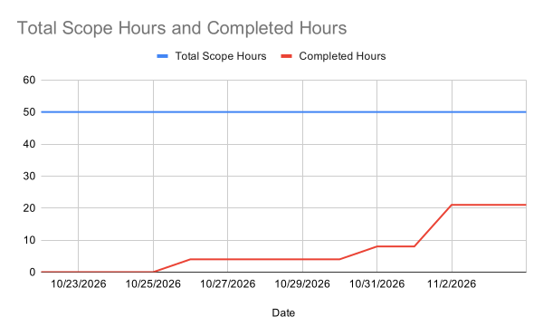

# Sprint 2 Report

- **Product Name:** Verilet
- **Team Name:** Verilet
- **Date:** November 4, 2026
- **Team Members & Roles:**
  - Yifei Peng — Product Owner
  - Devarsh Krishnan Jayakrishnan — Team Member
  - Aubrey Hayes — Team Member
  - Lars Voigt-Bui — Scrum Master
  - Adan Magaña-Bravo — Team Member

---

## Actions to Stop Doing

1. **The team determined there are currently no specific process activities to stop doing.**  
   _Explanation:_ The team is completely satisfied with our core operational rhythms established in Sprint 1 (such as holding our regular Discord scrum meetings, sending meeting reminders, and alerting teammates when PRs need review). Our process improvement efforts this sprint are focused on adding in-person working sessions and refining ticket clarity rather than eliminating existing process habits.

---

## Actions to Start Doing

1. **Start meeting more in person for working sessions and discussions.**  
   _Explanation:_ Even though team members have varied schedules and we consistently meet daily for our virtual scrum meetings, we should really try to have most if not all people meet in person to work and to discuss and work on similar things we would usually go over in virtual meetings. Technical problems, debugging hurdles, and architectural decisions are much easier to understand and resolve when discussed together in person.

2. **Start creating more detailed, accurate, and agreed-upon tickets during sprint planning.**  
   _Explanation:_ Sometimes tickets in Sprint 2 were a little hard to understand. If the user stories and technical sub-tasks are not clearly defined, understood, and agreed upon by the team upfront, then it becomes much harder to implement and verify them within the 14-day sprint timeframe.

---

## Actions to Keep Doing

1. **Keep holding recurring scrum meetings and sending meeting reminders on Discord.**  
   _Explanation:_ Having our scheduled scrum meetings (including our regular Wednesday and Friday sessions each week) lets the entire team know everyone's progress with their current tasks. Along with that, sending out reminders to meet on those days via Discord is really helpful so that no one forgets about meeting.

2. **Keep notifying the team on Discord whenever a new pull request is opened.**  
   _Explanation:_ Messaging the team in Discord chat for someone to review their new PR makes sure that all incoming work can be reviewed in a timely manner in case of acceptance or rejection of work.

---

## Work Completed / Not Completed

### User Stories Completed During Sprint 2

- **Fully Completed User Stories:** **0 user stories**  
  _Explanation:_ In accordance with Verilet's Definition of Done and CSE 115A sprint criteria, a user story is marked completed only when all acceptance criteria, technical sub-tasks, automated Vitest test suites, and peer code reviews are approved and merged to `main`. Because each user story in Sprint 2 involved multiple full-stack sub-tasks that spanned across the sprint boundary or remained in active code review at sprint close, 0 user stories were 100% completed.

- **Technical Sub-Tasks Completed from Sprint 2 User Stories (21.0 Ideal Work Hours):**
  1. **`SCRUM-3-T-1`**: Build `POST /api/scrape` endpoint with Schema.org JSON-LD extraction, OpenGraph metadata fallback, and 5000ms timeout handling.
     - _Parent Story:_ User Story 2 (`SCRUM-3`: Paste listing link)
     - _Assignee:_ Aubrey Hayes
     - _Estimated Ideal Work Hours:_ 4.0 hours
  2. **`SCRUM-3-T-2`**: Dedicated Craigslist Cheerio HTML scraper with text sanitization, price normalization, and domain routing.
     - _Parent Story:_ User Story 2 (`SCRUM-3`: Paste listing link)
     - _Assignee:_ Aubrey Hayes
     - _Estimated Ideal Work Hours:_ 6.0 hours
  3. **`SCRUM-18-T-1`**: Regex payment worker scanning listing descriptions for cryptocurrency terms, wire transfers, and gift cards with structured violation objects.
     - _Parent Story:_ User Story 3 (`SCRUM-18`: High-risk payment alerts)
     - _Assignee:_ Lars Voigt-Bui
     - _Estimated Ideal Work Hours:_ 6.0 hours
  4. **`SCRUM-19-T-2`**: HUD Fair Market Rent benchmark lookup table for Santa Cruz-Watsonville and room sublease baseline thresholds.
     - _Parent Story:_ User Story 4 (`SCRUM-19`: Below-market price alert)
     - _Assignee:_ Yifei Peng
     - _Estimated Ideal Work Hours:_ 5.0 hours
  5. **`SCRUM-48-T-7`**: Check page 3-step explanation layout and wireframes.
     - _Parent Story:_ User Story 1 (`SCRUM-48`: Short explanation of how Verilet works)
     - _Assignee:_ Devarsh Krishnan Jayakrishnan
     - _Completed Work:_ Wireframe design and initial layout

---

### User Stories Not Completed During Sprint 2

_The following 5 user stories were planned for Sprint 2 (and part of the sprint plan). Each story had active work completed as shown above, but remained partially completed at the November 4 cutoff and rolls over into Sprint 3:_

1. **User Story 1: As a student, I want a short explanation of how Verilet works, so I know what to enter and what my result means.**
   - _Story Points:_ 5 | _Priority Rating:_ 2
   - _Completed in Sprint 2:_ 1 sub-task (`SCRUM-48-T-7`: 3-step explanation layout and wireframes).
   - _Remaining Work / Reason Not Completed:_ The interactive animated road-style route (`SCRUM-48-T-8`) remained in development and rolls over into Sprint 3.

2. **User Story 2: As a student, I want to paste a listing link so that I don't have to spend time typing out information by hand while still having the chance to verify it.**
   - _Story Points:_ 8 | _Priority Rating:_ 2
   - _Completed in Sprint 2:_ 2 sub-tasks (`SCRUM-3-T-1` [4.0 hrs] and `SCRUM-3-T-2` [6.0 hrs] — 10.0 hrs total).
   - _Remaining Work / Reason Not Completed:_ The frontend URL input component with loading spinner (`SCRUM-3-T-3` [5.0 hrs]) and form redirect/inline review alert (`SCRUM-3-T-4` [5.0 hrs]) roll over into Sprint 3.

3. **User Story 3: As a student, I want the system to alert me if the lister asks for high-risk payment methods so that I don't send money through unsafe methods.**
   - _Story Points:_ 5 | _Priority Rating:_ 3
   - _Completed in Sprint 2:_ 1 sub-task (`SCRUM-18-T-1` [6.0 hrs]: Crypto, wire transfer, and gift card scanner).
   - _Remaining Work / Reason Not Completed:_ The proximity regex detecting P2P cash app advance-fee terms (`SCRUM-18-T-2` [6.0 hrs]) remained in progress and rolls over into Sprint 3.

4. **User Story 4: As a student, I want to be told if the listing is greatly below the average rental price so that I don't fall for a listing that's too good to be true.**
   - _Story Points:_ 5 | _Priority Rating:_ 3
   - _Completed in Sprint 2:_ 1 sub-task (`SCRUM-19-T-2` [5.0 hrs]: HUD Fair Market Rent benchmark tables).
   - _Remaining Work / Reason Not Completed:_ The outlier comparison math / service logic (`SCRUM-19-T-1` [6.0 hrs]) and MongoDB Atlas test database setup (`SCRUM-19-T-3` [2.0 hrs]) roll over into Sprint 3.

5. **User Story 5: As a student, I want to fill out a simple form about a rental listing, so I can check if it's a scam.**
   - _Story Points:_ 8 | _Priority Rating:_ 1
   - _Completed in Sprint 2:_ Core manual form component with inputs for rent, address, space type, and listing description.
   - _Remaining Work / Reason Not Completed:_ Substantially implemented, but was undergoing PR review adjustments and input validation edge-case handling at the end of the sprint; did not pass final review in time to merge before the cutoff and rolls over into Sprint 3.

---

## Work Completion Rate

- **Total User Stories Fully Completed:** 0 user stories (all 5 user stories partially completed)
- **Total Sub-Tasks Completed from User Stories:** 5 sub-tasks
- **Total Estimated Ideal Work Hours Completed:** 21.0 hours
  - _`SCRUM-3-T-1` (Scrape endpoint & JSON-LD parser):_ 4.0 ideal work hours
  - _`SCRUM-3-T-2` (Dedicated Craigslist Cheerio scraper):_ 6.0 ideal work hours
  - _`SCRUM-18-T-1` (Crypto & wire transfer regex scanner):_ 6.0 ideal work hours
  - _`SCRUM-19-T-2` (HUD Fair Market Rent benchmarks):_ 5.0 ideal work hours
- **Total Days in Sprint 2:** 14 days _(October 22 – November 4, 2026)_

### Sprint 2 Velocity

- **User Stories Completed per Day:**  
  $$\frac{0\text{ full stories}}{14\text{ days}} = 0.00\text{ stories/day} \quad \left(\text{or } \frac{5\text{ completed sub-tasks}}{14\text{ days}} = 0.36\text{ sub-tasks/day}\right)$$

- **Ideal Work Hours Completed per Day:**  
  $$\frac{21.0\text{ ideal hours}}{14\text{ days}} = 1.50\text{ ideal hours/day}$$

### Multi-Sprint Averages

_Computed across all sprints to date (Sprint 1: 14 days, Sprint 2: 14 days; Total: 28 days):_

- **Total Ideal Work Hours Completed Across All Sprints:**  
  $$21.75\text{ hours (S1)} + 21.00\text{ hours (S2)} = 42.75\text{ ideal work hours}$$

- **Average Ideal Work Hours Completed per Day (Across All Sprints):**  
  $$\frac{42.75\text{ ideal hours}}{28\text{ days}} = 1.53\text{ ideal hours/day}$$

- **Average Fully Completed User Stories per Day (Across All Sprints):**  
  $$\frac{10\text{ stories (S1)} + 0\text{ stories (S2)}}{28\text{ days}} = \frac{10}{28} = 0.36\text{ stories/day}$$

- **Average Completed Work Tasks / Sub-Tasks per Day (Across All Sprints):**  
  $$\frac{10\text{ tasks (S1)} + 5\text{ sub-tasks (S2)}}{28\text{ days}} = \frac{15}{28} = 0.54\text{ task units/day}$$

---

## Sprint Burnup Chart

_The final sprint burnup chart for Sprint 2 is embedded above, available for viewing in the lab, and submitted alongside this report._

- **Total Planned Scope:** 50.00 Ideal Work Hours (5 User Stories)
- **Completed Work:** 21.00 Ideal Work Hours (5 Completed Sub-tasks)
- **Remaining / Carried Over:** 29.00 Ideal Work Hours (Continuing into Sprint 3)
