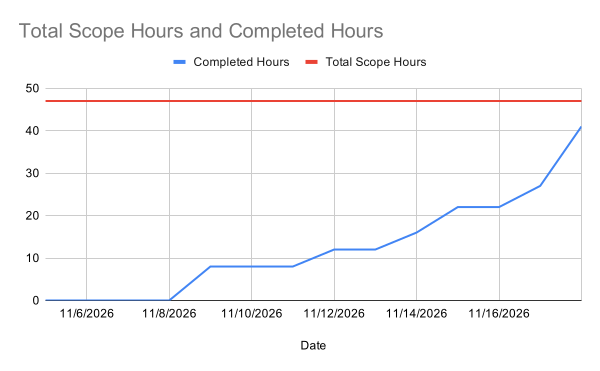

# Sprint 3 Report

- **Product Name:** Verilet
- **Team Name:** Verilet
- **Date:** November 19, 2026
- **Team Members & Roles:**
  - Aubrey Hayes — Scrum Master
  - Yifei Peng — Product Owner
  - Devarsh Krishnan Jayakrishnan — Team Member
  - Lars Voigt-Bui — Team Member
  - Adan Magaña-Bravo — Team Member

---

## Actions to Stop Doing

1. **Stop assuming work started in a prior sprint is finished without a merged PR and passing test suite.**  
   _Explanation:_ At the end of Sprint 2, `SCRUM-18-T-1` was assumed to be finished and listed as prior work in the Sprint 3 planning document. However, its formal implementation, Vitest test suite, and task spec were not actually merged into `main` until mid-Sprint 3 (PR #20). This created ambiguity during sprint tracking, requiring an in-flight scope adjustment to formally re-add `SCRUM-18-T-1` (6 ideal hours) alongside `SCRUM-18-T-2` (6 ideal hours). Going forward, no task should be considered complete until all criteria are verified and its PR is merged.

2. **Stop modifying task estimates or scope without immediately updating sprint documentation.**  
   _Explanation:_ When the scope of `SCRUM-19-T-3` expanded from 2 to 3 ideal hours and `SCRUM-18` was split into two 6-hour tasks, the changes were reflected in the task specs and Jira but not immediately synchronized in the sprint planning document. Keeping the planning doc, backlog, and review notes updated in real time ensures burnup tracking remains completely transparent.

---

## Actions to Start Doing

1. **Start conducting a mid-sprint scope reconciliation during Wednesday standups.**  
   _Explanation:_ Several tasks underwent scope adjustments mid-sprint (such as `SCRUM-19-T-3` requiring a dedicated test database configuration, and `SCRUM-18` splitting into two separate tasks). Spending five minutes during our mid-week standup to reconcile open tasks and estimates against Jira and the burnup baseline will catch scope drift early and keep velocity projections accurate.

2. **Start staggering pull request submissions to avoid end-of-sprint review bottlenecks.**  
   _Explanation:_ Although the team achieved outstanding development throughput in Sprint 3 (completing 46 ideal work hours vs 21 in Sprint 2), a significant number of PRs converged in the final 72 hours of the sprint (`SCRUM-19-T-1`, `SCRUM-19-T-3`, `SCRUM-3-T-3`, and `SCRUM-48-T-8`). Submitting independent backend service PRs earlier in the sprint will provide reviewers with a steady cadence and avoid last-minute merge rushes.

---

## Actions to Keep Doing

1. **Keep conducting rapid peer code reviews with active Discord notifications.**  
   _Explanation:_ As soon as a pull request was opened or revised, teammates notified reviewers on Discord. Reviewers responded promptly with actionable feedback and approvals, allowing 11 tasks to merge successfully and dramatically increasing team velocity.

2. **Keep enforcing strict 1-to-1 Vitest test mapping for all acceptance criteria.**  
   _Explanation:_ Meticulously naming each test with `[Criterion N]` (per style guide §3.2) and testing behavior offline with mock fixtures provided immense stability. All 6 completed user stories passed automated CI validation with zero regressions across both client and server packages.

3. **Keep utilizing our scheduled weekly scrum standups and TA check-ins.**  
   _Explanation:_ Our Monday TA/tutor visit and Wednesday/Friday online standups kept everyone aligned on priorities, blockers, and cross-package integrations across the monorepo.

---

## Work Completed / Not Completed

### User Stories Completed During Sprint 3

- **Fully Completed User Stories:** **6 user stories**  
  _Explanation:_ In accordance with Verilet's Definition of Done and CSE 115A sprint criteria, a user story is marked completed only when all constituent tasks, acceptance criteria, automated Vitest test suites, and peer code reviews are approved and merged to `main`. In Sprint 3, 6 out of 7 planned user stories achieved 100% completion across both the task and user story levels:
  1. `SCRUM-3`: Paste listing link to extract details (8 pts · Aubrey Hayes)
  2. `SCRUM-15`: Fill out simple rental listing form (8 pts · Devarsh Krishnan Jayakrishnan)
  3. `SCRUM-21`: Flag illegal security deposits & excessive application fees (Aubrey Hayes)
  4. `SCRUM-20`: Confirm property exists and residential zoning (5 pts · Adan Magaña-Bravo)
  5. `SCRUM-19`: Alert if listing rent is greatly below average price (5 pts · Yifei Peng)
  6. `SCRUM-48`: Short explanation of how Verilet works (5 pts · Devarsh Krishnan Jayakrishnan)

- **Tasks Completed from Sprint 3 User Stories (46.0 Ideal Work Hours):**
  1. **`SCRUM-3-T-3`**: Build frontend URL search bar component with active loading spinner, client-side URL validation, and invalid URL alert banner.
     - _Parent Story:_ User Story 1 (`SCRUM-3`: Paste listing link)
     - _Assignee:_ Aubrey Hayes
     - _Estimated Ideal Work Hours:_ 5.0 hours
  2. **`SCRUM-3-T-4`**: Connect scraper response handler to auto-populate form inputs, switch to manual form tab, and display inline review prompt.
     - _Parent Story:_ User Story 1 (`SCRUM-3`: Paste listing link)
     - _Assignee:_ Aubrey Hayes
     - _Estimated Ideal Work Hours:_ 5.0 hours  
       _Note: Implemented, tested, and delivered collaboratively under PR #24 (`closes SCRUM-3`), fully satisfying the 10 ideal hours planned for User Story 1._
  3. **`SCRUM-15-T-1`**: Finalize PR review revisions, input validation edge-cases, and merge manual listing form to receive scraper autofill.
     - _Parent Story:_ User Story 2 (`SCRUM-15`: Fill out simple rental listing form)
     - _Assignee:_ Devarsh Krishnan Jayakrishnan
     - _Estimated Ideal Work Hours:_ 0.0 hours _(Implementation credited in Sprint 2; PR review revisions and final merge completed in Sprint 3)_
  4. **`SCRUM-21-T-1`**: Create `securityDeposit.service.ts` with Zod schema, California AB 12 deposit cap evaluation, standardized result envelope, and Vitest suite.
     - _Parent Story:_ User Story 3 (`SCRUM-21`: Flag illegal security deposits & fees)
     - _Assignee:_ Aubrey Hayes
     - _Estimated Ideal Work Hours:_ 4.0 hours
  5. **`SCRUM-21-T-2`**: Create `applicationFee.service.ts` with Zod schema, California Civil Code § 1950.6 $65 statutory fee limit check, standardized result envelope, and Vitest suite.
     - _Parent Story:_ User Story 3 (`SCRUM-21`: Flag illegal security deposits & fees)
     - _Assignee:_ Aubrey Hayes
     - _Estimated Ideal Work Hours:_ 4.0 hours
  6. **`SCRUM-20-T-1`**: Create `gisLandUse.service.ts` with `GisAddressInputSchema` and Santa Cruz County Assessor MapServer ArcGIS REST query builder with normalized address matching and 5000ms timeout handling.
     - _Parent Story:_ User Story 4 (`SCRUM-20`: Confirm property exists & residential zoning)
     - _Assignee:_ Adan Magaña-Bravo
     - _Estimated Ideal Work Hours:_ 4.0 hours
  7. **`SCRUM-20-T-2`**: Implement assessor `USECDDESC` land use code evaluation, non-residential/unverified flag triggers, standardized JSON envelope, and offline Vitest tests with mocked parcel fixtures.
     - _Parent Story:_ User Story 4 (`SCRUM-20`: Confirm property exists & residential zoning)
     - _Assignee:_ Adan Magaña-Bravo
     - _Estimated Ideal Work Hours:_ 4.0 hours
  8. **`SCRUM-18-T-1`**: Flag untraceable payment terms (crypto, wire transfers, gift cards) in listing text with structured violation objects (`server/services/paymentFlags.service.js`).
     - _Parent Story:_ User Story 5 (`SCRUM-18`: High-risk payment method alerts)
     - _Assignee:_ Lars Voigt-Bui
     - _Estimated Ideal Work Hours:_ 6.0 hours
  9. **`SCRUM-19-T-1`**: Implement `averagePrice.service.ts` comparing listing rent against Santa Cruz and San Jose median baseline thresholds from MongoDB Atlas.
     - _Parent Story:_ User Story 6 (`SCRUM-19`: Below-market rent outlier alert)
     - _Assignee:_ Yifei Peng
     - _Estimated Ideal Work Hours:_ 6.0 hours
  10. **`SCRUM-19-T-3`**: Read rent data from the database named in `RENT_DB_NAME`, document test replica database, and write offline Vitest tests.
      - _Parent Story:_ User Story 6 (`SCRUM-19`: Below-market rent outlier alert)
      - _Assignee:_ Yifei Peng
      - _Estimated Ideal Work Hours:_ 3.0 hours _(Scope increased from initial 2.0h estimate to accommodate Zod name validation and test database configuration)_
  11. **`SCRUM-48-T-8`**: Build interactive road-style "How it works" animated visualization route (`/how-it-works`) explaining the 4-tier verification process with scroll-driven car animation.
      - _Parent Story:_ User Story 7 (`SCRUM-48`: Explanation of how Verilet works)
      - _Assignee:_ Devarsh Krishnan Jayakrishnan
      - _Estimated Ideal Work Hours:_ 5.0 hours

---

### User Stories Not Completed During Sprint 3

_The following user story was planned for Sprint 3 and actively developed, but remained partially completed at the November 19 cutoff and rolls over into Sprint 4:_

1. **User Story 5: As a student, I want the system to alert me if the lister asks for high-risk payment methods so that I don't send money through unsafe methods.**
   - _Jira Key:_ `SCRUM-18` | _Story Points:_ 5 | _Priority Rating:_ 3
   - _Completed in Sprint 3:_ 1 task (`SCRUM-18-T-1` [6.0 hrs]: Flag untraceable payment terms such as cryptocurrency, wire transfers, and gift cards, merged via PR #20).
   - _Remaining Work / Reason Not Completed:_ The second task, `SCRUM-18-T-2` (6.0 hrs: Proximity regex detecting P2P cash app advance-fee terms paired with deposit requests), was in active development (Jira `SCRUM-37`: In Progress) but was not finalized or merged before the sprint deadline. In accordance with our Definition of Done, parent story `SCRUM-18` rolls over into Sprint 4.

---

## Work Completion Rate

- **Total User Stories Fully Completed:** 6 user stories
- **Total Tasks Completed from User Stories:** 11 tasks
- **Total Estimated Ideal Work Hours Completed:** 46.0 hours
- **Total Days in Sprint 3:** 14 days _(November 5 – November 19, 2026)_

### Sprint 3 Velocity

- **User Stories Completed per Day:**  
  $$\frac{6\text{ stories}}{14\text{ days}} = 0.43\text{ stories/day}$$

- **Tasks Completed per Day:**  
  $$\frac{11\text{ tasks}}{14\text{ days}} = 0.79\text{ tasks/day}$$

- **Ideal Work Hours Completed per Day:**  
  $$\frac{46.0\text{ ideal hours}}{14\text{ days}} = 3.29\text{ ideal hours/day}$$

### Multi-Sprint Averages

_Computed across all sprints to date (Sprint 1: 14 days, Sprint 2: 14 days, Sprint 3: 14 days; Total: 42 days):_

- **Total Ideal Work Hours Completed Across All Sprints:**  
  $$21.75\text{ hours (S1)} + 15.00\text{ hours (S2)} + 46.00\text{ hours (S3)} = 82.75\text{ ideal work hours}$$

- **Average Ideal Work Hours Completed per Day (Across All Sprints):**  
  $$\frac{82.75\text{ ideal hours}}{42\text{ days}} = 1.97\text{ ideal hours/day}$$

- **Average Fully Completed User Stories per Day (Across All Sprints):**  
  $$\frac{10\text{ stories (S1)} + 0\text{ stories (S2)} + 6\text{ stories (S3)}}{42\text{ days}} = \frac{16}{42} = 0.38\text{ stories/day}$$

- **Average Completed Work Tasks per Day (Across All Sprints):**  
  $$\frac{10\text{ tasks (S1)} + 4\text{ tasks (S2)} + 11\text{ tasks (S3)}}{42\text{ days}} = \frac{25}{42} = 0.60\text{ task units/day}$$

---

## Sprint Burnup Chart

_The final sprint burnup chart for Sprint 3 is embedded above, available for viewing in the lab, and submitted alongside this report._

- **Initial Planned Scope:** 45.00 Ideal Work Hours (7 User Stories)
- **Scope Adjustments:** +7.00 Ideal Work Hours (Final Scope: 52.00 Ideal Work Hours)
  - _`SCRUM-18` Scope Addition (+6.0h):_ User Story 5 was split into two 6-hour tasks (`SCRUM-18-T-1` [6h] and `SCRUM-18-T-2` [6h]), bringing `SCRUM-18-T-1` into Sprint 3 scope.
  - _`SCRUM-19-T-3` Scope Increase (+1.0h):_ Increased from 2.0 to 3.0 ideal work hours to cover `RENT_DB_NAME` Zod validation, Atlas replica cluster documentation, and Vitest isolation.
- **Completed Work:** 46.00 Ideal Work Hours (6 Fully Completed User Stories, 11 Completed Tasks)
- **Remaining / Carried Over:** 6.00 Ideal Work Hours (`SCRUM-18-T-2`: P2P cash-app advance fee proximity regex)
